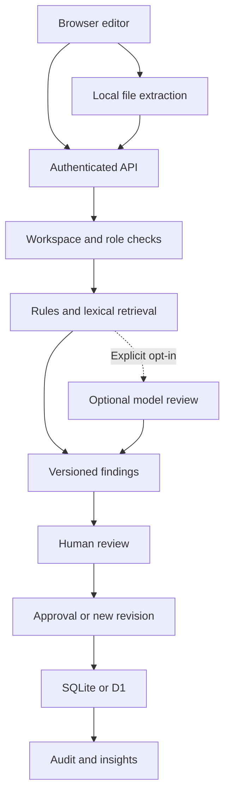
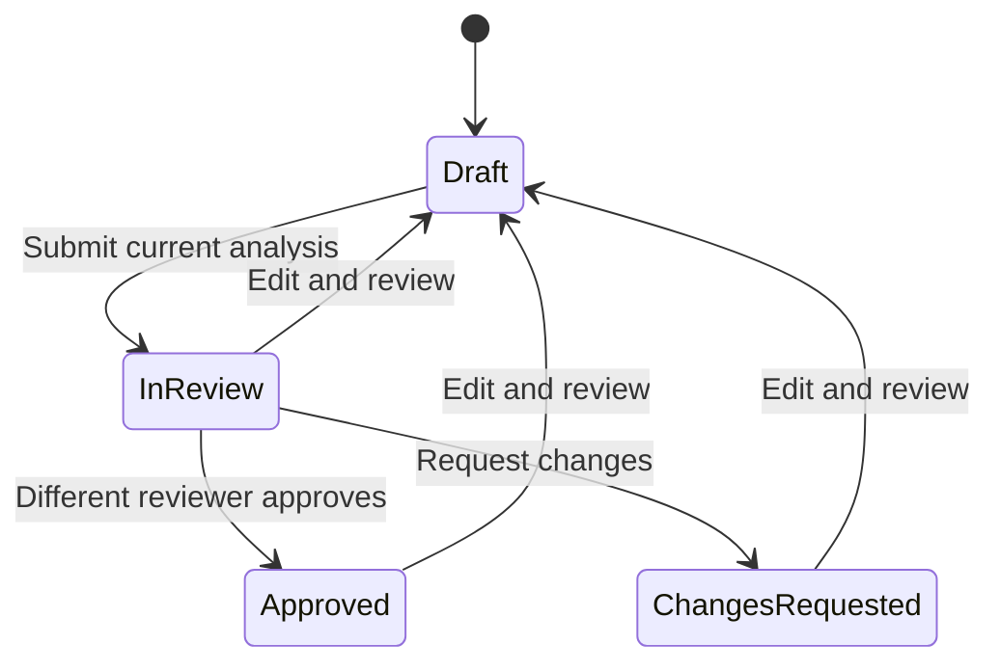

# How BrandCompass works

## Request and evidence flow

All core server functions use the Web Request/Response and Web Crypto APIs. This lets the same API and review engine run locally in Node or in a Cloudflare Worker. Local `src/local-db.mjs` adapts `node:sqlite` to the D1 `prepare().bind().first()/all()/run()` interface. It applies the same SQL migrations. No independent Python service is needed.

## Data model

- `organisations`: tenant ID, organisation name, demo flag, versioned JSON workspace state and optimistic-lock revision.
- `users`: tenant ID, unique email, name, role, PBKDF2 password hash and unique salt.
- `sessions`: SHA-256 digest of a random session token, user ID and expiry.
- `rate_limits`: bounded request-window counts by authentication IP, login email and authenticated user.
- Workspace state contains brand settings, versioned rules/facts, asset fingerprints, content revisions, comments, decisions and audit records.

The prototype uses one JSON document per organisation so a content change, revision and audit event can be committed together with one compare-and-swap update. A matching revision is required; concurrent stale writes receive HTTP 409. This is convenient for a bounded hackathon workspace. For larger deployments, normalise content, versions, findings, decisions and events into indexed tenant-scoped tables.

## Review pipeline

1. Validate bounded text, colour pairs and image metadata.
2. Match configured terminology as literal, case-insensitive whole words. Suggestions preserve exact offsets.
3. Run phrase, capitalization, punctuation, sentence-length and offer-condition rules.
4. Detect candidate factual claims using numeric and promotional trigger patterns.
5. Require full normalized-sentence equality with a non-expired approved fact to mark a detected claim supported. Normalization folds punctuation/case and the INR currency symbol; it does not remove negations or qualifiers.
6. Rank related sources using shared meaningful words divided by the square root of the source token count. Similarity supplies context and possible edits, never automatic proof.
7. Inspect declared foreground/background contrast, image alt metadata, graphic palette samples and exact logo fingerprint matches.
8. If requested and configured, send draft text plus up to eight retrieved sources to the model. Validate returned citation IDs and quoted spans before accepting advisory findings. AI output never directly modifies text or approves it.
9. Persist analysis with its engine version, knowledge version, sources, review time and AI disclosure.

The browser calculates image fingerprints and colours from actual uploaded files. These are user-supplied metadata, not independently verified server-side image forensics. A hostile client could alter them; the prototype is a collaborative reviewer rather than an adversarial asset-certification service.

## Approval invariants

A reviewer must be a different user from both the creator and last editor. A high finding must be fixed or explicitly overridden by an authorised role. An approval cannot use stale knowledge. Editing resets approval, increments the content version and keeps the prior snapshot. Ordinary comments do not create a content revision. Decisions cannot change on an already approved revision.

## Scores

- Check score = `max(0, 100 - 18 × high - 8 × medium - 3 × low)`.
- Guideline health = `100 × (1 - (dismissed + overridden current findings) / all current findings)`.
- A rule with no observed flags has **no data**, not 100% health.
- Overrides do not raise the check score. Counts use the latest revision per draft; past decisions remain in snapshots and the audit trail.

Neither metric is a truth probability, business KPI or independently validated accuracy measurement.

## Important endpoints

| Method and route | Purpose |
|---|---|
| POST `/api/signup`, `/api/login`, `/api/logout` | Accounts and sessions |
| POST `/api/demo` | New isolated seeded demo |
| POST `/api/demo/role` | Persona switching, demo tenants only |
| GET `/api/state` | Current user, workspace, records, revision and insights |
| GET `/api/search?q=...` | Related approved evidence |
| POST `/api/knowledge` | Versioned rule, fact, palette or asset update |
| POST `/api/reviews` | Create and analyse content |
| POST `/api/reviews/:id` | Save/apply/comment/submit/decide/approve/request changes |
| GET `/api/audit` | Verify and return the hash chain |
| GET `/api/export` | Workspace JSON export, excluding credentials and sessions |
| GET/POST `/api/members` | Admin-only member listing and account creation |

Mutations require JSON, `X-BC-Request: 1`, a same-origin browser request, and (for workspace changes) the current `revision`. Authentication uses an HttpOnly SameSite cookie. The hosted Site adds its owner-only access gate outside the app.
